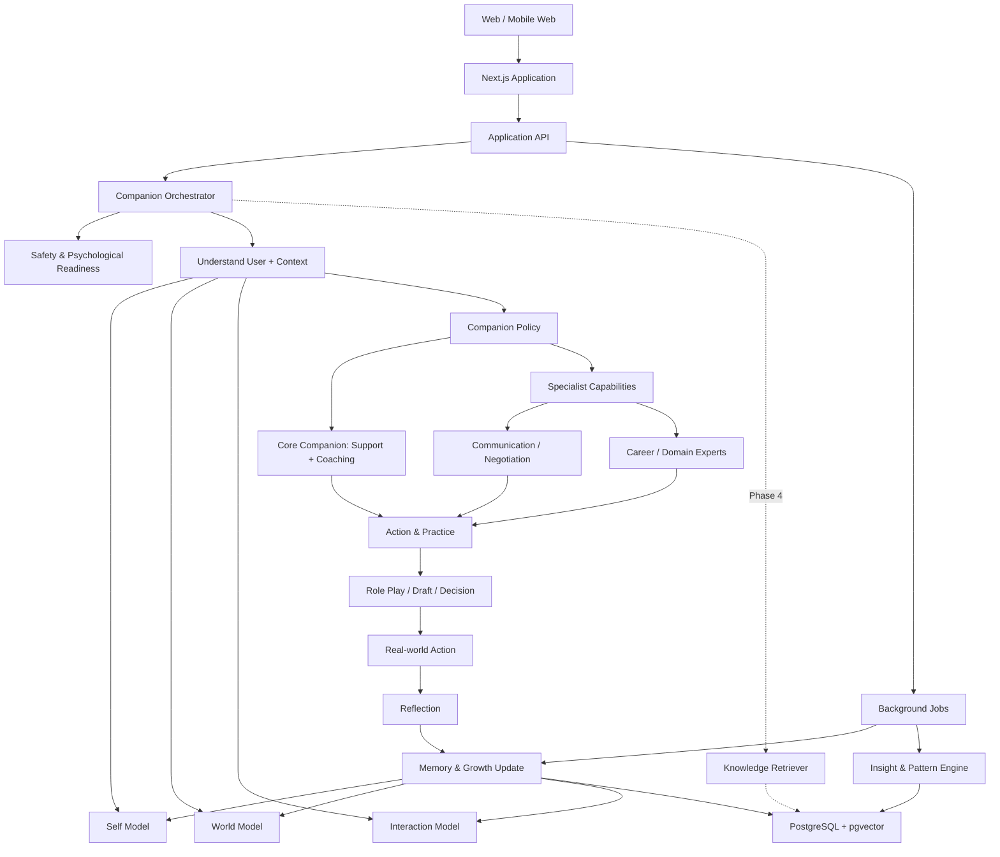
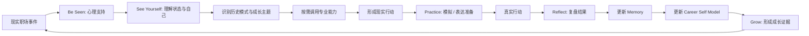
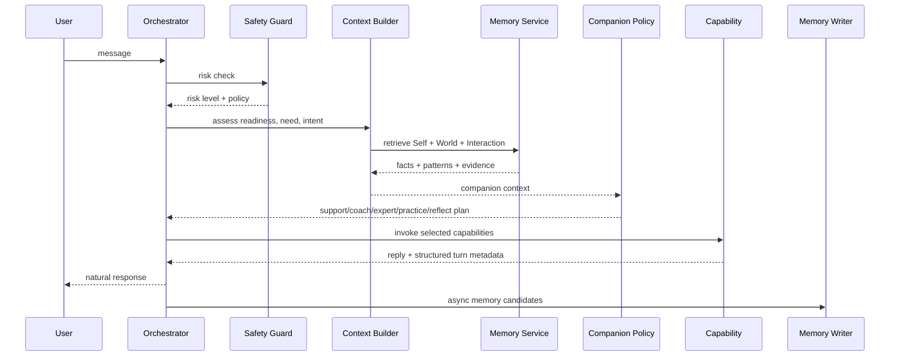
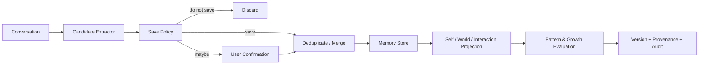
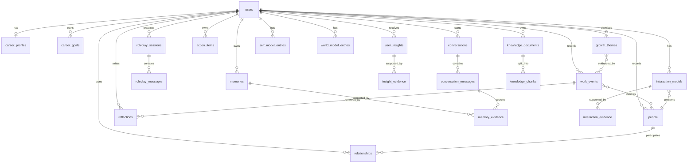

# AI 职场陪伴师（Career Companion）产品与技术架构

> 版本：MVP 方案 v1.1  
> 目标：先建立一套可验证“长期陪伴价值”的产品骨架，再逐步增强智能、记忆与知识库能力。

## 1. 产品定义与一期边界

### 1.1 产品使命

Career Companion 的核心不是“解决职场问题”，而是陪伴一个人的长期职场成长。它不是替用户做决定的问答机器人，而是通过 **Be Seen → See Yourself → Act → Reflect → Grow** 的 Career Growth Loop，帮助用户理解自己、看懂所处的职场世界、尝试新的行为，并逐渐形成自己的职场方法论。

产品最重要的回访时刻不是“每天”，而是用户再次遇到压力、冲突、选择或发展问题时。他愿意回来，是因为这里知道他经历过什么、面对过谁、尝试过什么，以及他正在成为怎样的人。

核心价值可以压缩为三个结果：

1. 用户更清楚：发生了什么、自己在意什么、什么可控。
2. 用户能行动：形成一个具体、低风险、可复盘的下一步。
3. 用户看见成长：系统能基于证据呈现反复出现的模式和真实变化。
4. 用户逐渐独立：把原本需要 AI 协助的澄清、判断和表达过程内化成自己的能力。

### 1.2 产品原则

- **Ask before advise**：信息不足时先问最关键的一个问题。
- **心理空间优先**：先判断用户此刻是否有足够空间处理问题；压力支持贯穿所有模式，不是孤立功能。
- **先理解，再调用能力**：先理解用户、现实环境和历史模式，再决定此刻需要 Support、Coach、Expert、Practice 或 Reflect。
- **具体优先**：回答基于事件、目标、人物关系与环境限制。
- **证据优先**：人物判断、优势和成长洞察都必须保留来源与置信度。
- **用户可控**：长期记忆可查看、编辑、删除、关闭。
- **Dependency Reduction**：主动促进能力迁移；成功不是用户越来越依赖 AI，而是越来越能独立处理同类问题。

### 1.3 MVP 做什么

MVP 提供七个连贯页面：Home、Companion Chat、My Career、Workplace Map、Role Play、Reflection、Growth。首期只实现能闭环的核心路径：

- 快速开始一次倾诉、问题分析、模拟或复盘；
- 自动识别对话模式，并允许用户手动切换；
- 维护基础职业档案和重要人物；
- 完成一次角色模拟并生成具体复盘；
- 记录事件与行动项，在后续对话中跟进；
- 建立初步 Career Self Model 与 Growth Theme；
- 用少量、可解释、有证据的数据展示成长趋势。

### 1.4 MVP 暂不做

- 公司级协作、组织管理员、多租户计费；
- 全自动人格测评或职业测评；
- 复杂关系图谱算法；
- 大规模行业知识库与完整 RAG（只预留接口和数据表）；
- 自动替用户发送邮件/消息、做不可逆职业决定；
- 医疗诊断或心理治疗。出现自伤、伤人等高风险信号时进入安全响应，不继续普通 coaching。

## 2. 整体产品架构



### 2.1 分层职责

| 层 | 责任 | 不负责 |
|---|---|---|
| Experience | 页面、表单、对话流、状态反馈 | 推断用户人格 |
| Application | 鉴权、用例编排、事务、权限 | 把业务规则塞进组件 |
| Companion | 心理承接、理解用户、策略选择、保持长期成长方向 | 只按关键词分发问题 |
| Specialist | 沟通、谈判、职业决策、行业知识等专业能力 | 脱离 Companion 独立决定整体路径 |
| Action & Practice | 行动规划、表达草稿、模拟和决策支持 | 替用户执行高影响行为 |
| Memory | 候选提取、检索、合并、删除 | 将所有对话永久化 |
| Insight | 基于跨事件证据发现优势、重复模式与变化 | 关键词计数或单次对话下结论 |
| Knowledge | 行业/公司/项目知识检索 | 和个人记忆混为一谈 |
| Data | 结构化数据、审计、向量索引 | 决定对话策略 |

### 2.2 推荐技术栈

- 前端：Next.js App Router、React、TypeScript、Tailwind CSS、shadcn/ui。
- 服务端：首期使用 Next.js Route Handlers / Server Actions；业务增长后可将异步任务独立为 worker。
- 数据：PostgreSQL、Prisma、pgvector。
- AI：模型提供商适配层 + 结构化输出；不要在业务代码中直接绑定单一模型。
- 异步：首期可用数据库任务表；生产期接入队列处理记忆提取、洞察聚合、文档切块。
- 可观测性：结构化日志、trace_id、prompt_version、model、token/latency、工具调用结果；日志不得保存未脱敏敏感正文。

## 3. 信息架构与导航

主导航建议保持五个一级入口，降低认知负担：

1. **今天**：Home、Daily Check-in、待跟进行动。
2. **陪伴**：Companion Chat，承载倾听、探索、建议与复盘的统一入口。
3. **练习**：Role Play 及模拟历史。
4. **我的职场**：My Career、Workplace Map、职业目标。
5. **成长**：Growth、Reflection 历史、洞察与趋势。

“记忆与隐私”放在设置中，但在每条 AI 使用的记忆旁提供“为什么提到它”和快速编辑入口。

## 4. 用户核心流程

### 4.1 主循环



这个循环允许跳步：用户只要一句回复时可快速进入专业能力；用户情绪强烈时先停留在支持层。系统不能把所有输入都强制做成完整 coaching 流程。

### 4.2 首次使用

1. 用一句话说明产品边界与隐私原则。
2. 只收集最低必要信息：当前角色、行业、最想改善的一个主题；其余信息允许为空。
3. 用户选择“聊聊 / 解决问题 / 模拟 / 复盘”之一，立即进入价值体验。
4. 对话结束时提出一条记忆候选，并让用户选择保存、编辑或忽略。
5. 生成一个可执行下一步，可选日期与提醒，不强迫设长期目标。

### 4.3 普通陪伴对话

1. 用户输入后，先做安全检查与心理空间判断。
2. 从 Self、World、Interaction 三个模型检索本轮最相关的职业、人物、事件、模式和未完成行动。
3. Companion Policy 判断此刻需要心理承接、coaching、专业能力、练习还是复盘；关键词只提供信号，不能直接决定 Agent。
4. 系统先满足当前需要，并判断这是一次性问题还是某个长期主题的再次出现。
5. 每轮通常只推进一个关键问题；用户明确求方案时不连续盘问。
6. 会话结束生成摘要、事件、行动项和记忆候选；真实行动结果回来后才形成新的成长证据。

### 4.4 模拟与复盘

1. 选择人物（已有关系人物或通用角色）、场景、风格、难度和用户目标。
2. 系统展示模拟边界与停止口令；模拟中 Agent 始终留在角色内。
3. 用户选择“结束模拟”后才切换到教练视角。
4. 复盘包含：双方目标、做得好的具体表达、风险表达、替代版本、下一轮练习重点。
5. 用户可立即重练；比较两轮变化，不用泛泛评分。

### 4.5 真实事件复盘

采用六步短表单：事实经过 → 我的目标 → 对方反应 → 结果 → 有效动作 → 下次实验。AI 可从聊天补全草稿，但事实必须由用户确认。

### 4.6 从一次性问题到长期成长

对于新事件，系统在不打断自然对话的前提下检查：过去是否存在心理反应和行为选择相似的事件；是否关联同一 Growth Theme；这一次是否出现了不同做法。只有证据达到阈值时，才以邀请确认的方式提出模式，例如“这些事情来自不同的人，但当对方强调紧急时，你似乎常常先承担下来。你自己有这种感觉吗？”

## 5. AI Agent 架构

Agent System 采用层级编排，而不是 `Router → 独立 Agent → Answer`。**Core Companion 是大脑，Domain Expert 是工具**：前者负责理解用户、心理状态、上下文和长期成长方向；后者只在需要时提供专业能力。

### 5.1 四层能力层级

| 层 | 组成 | 核心职责 |
|---|---|---|
| Core Companion | Psychological Support、Life Coaching、Career Coaching、Strength/Pattern Discovery | 理解用户、恢复心理空间、决定对话方向 |
| Specialist Capability | Communication、Negotiation、Career Decision、Project Management、ToG、FinTech | 为具体问题提供专业分析，不主导长期关系 |
| Action & Practice | Action Planning、Communication Draft、Role Play、Decision Support | 把理解转成可尝试的现实行为 |
| Memory & Growth | Self/World/Interaction Model、Reflection、Insight Engine | 连接过去与现在，更新证据和成长主题 |

### 5.2 核心模式

内部模式枚举：

```text
LISTENING     情绪倾诉
COACHING      问题探索
ADVICE        寻找方案
ROLEPLAY      沟通模拟
REFLECTION    事后复盘
CAREER        职业方向与决策
SAFETY        高风险安全响应
```

模式不是七个完全独立的聊天机器人，而是 Companion Policy 可组合的策略。Psychological Support 是所有非安全模式的基础能力，不另建一个只能“管理压力”的孤立页面或机器人。

### 5.3 单轮编排流程



### 5.4 Companion Context 与 Policy 契约

```ts
type CompanionContext = {
  mode: "LISTENING" | "COACHING" | "ADVICE" | "ROLEPLAY" | "REFLECTION" | "CAREER" | "SAFETY";
  confidence: number;
  userNeed: string;
  directAnswerRequested: boolean;
  emotionalIntensity: "low" | "medium" | "high";
  psychologicalReadiness: "low" | "medium" | "high";
  safetyLevel: "normal" | "watch" | "urgent";
  problemScope: "one_off" | "possible_recurring" | "confirmed_growth_theme";
  selfContextIds: string[];
  worldContextIds: string[];
  interactionContextIds: string[];
};

type CompanionPlan = {
  primaryMove: "support" | "coach" | "expert" | "practice" | "reflect" | "safety";
  specialistCapabilities: Array<"communication" | "negotiation" | "career_decision" | "project_management" | "tog" | "fintech">;
  responseGoal: string;
  askAtMostOneQuestion: boolean;
  proposedAction?: string;
  patternCandidateId?: string;
  requiresUserConfirmation: boolean;
};
```

低置信度时使用当前会话模式和用户显式入口作为优先信号，并允许用户一键切换“先听我说 / 帮我分析 / 直接给建议”。出现“项目经理”等领域词不等于调用领域 Agent；需结合用户需求、心理空间和历史模式决定。

### 5.5 各能力职责

- **Psychological Support**：倾听、承接情绪、降低认知负荷、把模糊压力具体化、恢复控制感；不诊断、不治疗。
- **Coach Agent**：使用 C.A.R.E. 作为内部框架；探索需要、价值、动机、能量来源与成长主题，输出自然对话。
- **Communication Agent**：分析双方目标、事实、风险与表达结构，提供温和/专业/强边界版本。
- **Role-play Agent**：严格遵守角色、已知事实和难度设定；不在模拟中泄露教练分析。
- **Reflection Agent**：从具体语言和节点提炼有效动作、失控点与下次实验。
- **Career Agent**：支持职业选择、转型、加薪、失业等决策，显式比较财务安全、机会、成长、环境、心理成本和替代方案。

### 5.6 Prompt 分层

不要使用单一巨型 prompt。建议组合：

```text
prompts/
  base/personality
  base/safety
  base/privacy
  companion/readiness-assessor
  companion/context-builder
  companion/policy
  companion/psychological-support
  agents/coach
  agents/communication
  agents/roleplay
  agents/reflection
  agents/career
  memory/extractor
  memory/consolidator
  insight/pattern-detector
```

每次请求由“基础人格 + 安全边界 + Companion Context + 当前能力 + 最小相关记忆 + 当前任务”组成，并记录 prompt_version。模型的结构化输出先通过 schema 校验，再进入业务层。

### 5.7 系统人格摘要

- 温暖、冷静、聪明、有洞察、有边界；尊重用户选择。
- 先判断用户此刻需要被听见、被澄清、得到方案还是练习。
- 一次通常探索一个关键问题，短句、自然表达。
- 不贴人格标签，不把推测说成事实，不制造焦虑。
- 不轻率建议辞职；对重大决定展示条件、风险与替代路径。
- 引用历史信息时说明依据，例如“你之前两次提到……”，允许用户纠正。

## 6. Memory 架构

### 6.1 五类记忆

| 类型 | 内容 | 生命周期 | 例子 |
|---|---|---|---|
| Working | 当前会话上下文和临时状态 | 会话级 | 当前正在讨论延期 |
| Episodic | 有时间和参与人的具体事件 | 长期，可过期 | 8 月 20 日被催进度 |
| Semantic | 相对稳定的职业事实 | 长期 | 用户是数据分析师 |
| Relationship | 人物、关系、观察与策略 | 长期，需证据 | 张经理偏好简短汇报 |
| Growth | 行为模式、优势和变化 | 长期，多证据 | 被催后更常先澄清优先级 |

知识库不是个人记忆，必须使用独立来源与权限模型。

### 6.2 三个长期聚合模型

五类记忆是事实与证据层；其上构建三个可演化、可追溯的读取模型：

| 模型 | 回答的问题 | 主要内容 | 主要消费者 |
|---|---|---|---|
| **Self Model** | 用户是谁、正在成为谁？ | 角色、阶段、优势、价值、需要、压力源、能量来源、目标、工作偏好、重复模式、成长主题 | Coach、Career、Growth |
| **World Model** | 用户处在怎样的真实职场世界？ | 公司、行业、团队、项目、人物、组织限制、风险、重要事件 | Communication、Domain Expert、Workplace Map |
| **Interaction Model** | 用户与某个人/环境互动时会发生什么？ | 触发条件、心理反应、行为选择、对方反应、结果、有效策略及其变化 | Role Play、Communication、Reflection、Insight |

这些模型不是模型自由生成的一段总结，而是由带证据的 model entries 聚合而成。每个条目保留 `certainty`、`confidence`、`evidence_count`、`user_confirmation` 与版本；任何 UI 结论都可回溯到事件、反思、模拟或行动结果。

### 6.3 写入流水线



每条记忆必须带：`kind`、规范化内容、来源消息、时间范围、人物/事件关联、事实或推测、置信度、敏感级别、状态、版本。

### 6.4 写入规则

- **Save**：明确稳定的职业信息、重要人物、长期目标、重要事件、重复模式。
- **Maybe save**：偏好、对人物的观察、阶段困难；默认提出候选或等待更多证据。
- **Do not save**：随口闲聊、瞬时情绪、无意义信息、未经确认的敏感推断。
- “他是控制狂”记录为用户在特定事件中的感受/解释；不能写成人格事实。
- 人物特征至少保留 `observation` 与 `inference` 两层；推测可被新证据推翻。
- Growth Insight 至少需要两个独立事件，重要结论建议三个以上证据。
- 优势通过不同真实事件中的可观察行为形成；不生成无依据分数或固定人格标签。
- Strength Overuse 作为独立候选洞察保存，必须有多个事件证明同一优势在特定环境中带来成本。

### 6.5 检索策略

采用混合检索：结构化过滤（用户、人物、类型、时间、状态）+ 语义相似度 + 新近度 + 重要性。最终上下文按以下优先级裁剪：

1. 用户在当前消息明确提到的人物/事件；
2. 未完成行动项和最近相关事件；
3. 已确认的稳定职业事实；
4. 有多条证据的模式；
5. 当前事件相似的 Interaction Model 与关联 Growth Theme；
6. 低置信度推测只作为内部提示，不直接陈述。

### 6.6 重复模式与 Growth Theme

Insight Engine 不依赖简单关键词计数，而是在结构化事件特征上比较：`trigger_type + perceived_pressure + emotion/need + user_response + outcome`。它可以在不同人物和场景间发现相似链路，但必须执行以下门槛：

1. 至少两个独立事件才创建 `emerging` pattern candidate；重要结论建议三个以上事件。
2. 排除同一会话的重复表述，保留反例与无效证据。
3. 以“可能的共同点”邀请用户确认；用户可确认、修改或否认。
4. 确认后的模式可创建或关联 Growth Theme；行动与复盘持续更新它。

Growth Theme 状态为 `emerging / active / improving / dormant / resolved`，关联事件、人物、反思、模拟、行动和证据。它不同于 Career Goal：目标描述用户想获得的位置或结果，Growth Theme 描述用户正在练习和改变的能力/模式。

### 6.7 合并、过期与纠错

- 相同事实更新版本，不无止境新增重复记录。
- 时效性事实带 `valid_from/valid_to`，例如职位、汇报对象。
- 用户纠正拥有最高优先级；旧记录软失效但保留审计痕迹。
- 低置信度人物观察会随时间衰减；已确认事实不自动衰减。
- 删除人物时级联解除关系和向量索引，事件可选择匿名保留或一并删除。

### 6.8 隐私控制

- 设置页提供长期记忆总开关、记忆列表、按类型筛选、编辑、删除、导出。
- 关闭后停止新增长期记忆；Working Memory 仍可用于完成当前会话。
- 提供“这条记忆在哪里被使用”的可解释入口。
- 敏感字段应用层加密；访问按 user_id 强隔离；删除任务可审计并最终清除向量副本。
- 产品文案明确：请避免输入不必要的公司机密或可识别第三方隐私。

## 7. 数据库设计

### 7.1 核心实体关系



### 7.2 表设计

所有业务表使用 UUID、`created_at`、`updated_at`；用户数据表必须包含 `user_id`。需要删除审计的实体使用 `deleted_at`。

#### 身份与职业

- `users`：id、email/identity_provider、locale、timezone、memory_enabled、consent_version。
- `career_profiles`：user_id、current_role、industry、company_type、city、years_experience、salary_range_encrypted、team_size、manager_title、career_stage、profile_completeness。
- `career_goals`：user_id、horizon(short/mid/long)、title、description、status(unclear/active/paused/done)、target_date、confidence。
- `growth_themes`：user_id、title、description、status(emerging/active/improving/dormant/resolved)、origin_summary、confidence、user_confirmation、first_seen_at、last_seen_at。
- `growth_theme_links`：growth_theme_id、entity_type(event/person/reflection/roleplay/action/insight)、entity_id、relation_type、evidence_weight。

#### 人物与关系

- `people`：user_id、display_name、role_title、organization_alias、notes、sensitivity_level。
- `relationships`：user_id、person_id、relationship_type、closeness、influence_level、communication_summary。
- `person_observations`：person_id、kind(fact/observation/inference/feeling)、content、confidence、source_event_id、valid_from、valid_to、status。
- `communication_strategies`：person_id、context、strategy、evidence_count、effectiveness。

#### 对话、事件与行动

- `conversations`：user_id、mode、title、status、summary、started_at、ended_at。
- `conversation_messages`：conversation_id、role、content_encrypted、mode、model、prompt_version、token_usage、safety_level。
- `work_events`：user_id、title、occurred_at、event_type、facts、user_interpretation、emotion、concern、outcome、importance。
- `event_dynamics`：work_event_id、trigger_type、perceived_pressure、user_need、user_response、other_response、outcome_code；为跨场景模式检测提供可比较特征。
- `work_event_people`：work_event_id、person_id、role_in_event。
- `action_items`：user_id、source_type/source_id、description、due_at、status、result_note。
- `reflections`：user_id、work_event_id、goal_self、goal_other、what_happened、worked_well、improvements、next_experiment。

#### 模拟

- `roleplay_sessions`：user_id、person_id(nullable)、role_template、scenario、persona_style、difficulty、user_goal、status、review_json。
- `roleplay_messages`：session_id、role、content_encrypted、sequence_no、feedback_tags。

#### 记忆与洞察

- `memories`：user_id、type、canonical_text、structured_data(jsonb)、certainty(fact/inference)、confidence、importance、sensitivity、valid_from、valid_to、status、embedding、version。
- `memory_evidence`：memory_id、source_type、source_id、excerpt_hash、evidence_weight。
- `memory_links`：memory_id、entity_type、entity_id、relation_type。
- `user_insights`：user_id、type(strength/strength_overuse/pattern/stressor/growth/energy_source/value)、title、summary、confidence、user_confirmation、first_seen_at、last_seen_at、status。
- `insight_evidence`：insight_id、source_type、source_id、evidence_note、weight。
- `user_patterns`：user_id、trigger_signature、response_signature、outcome_signature、status(candidate/confirmed/rejected/superseded)、confidence、event_count、counterexample_count、user_confirmation。

#### 三个长期模型

- `self_model_entries`：user_id、category(strength/value/need/stressor/energy_source/work_style/aspiration/pattern)、statement、certainty、confidence、evidence_count、user_confirmation、valid_from、valid_to、version。
- `world_model_entries`：user_id、entity_type(company/team/project/person/constraint/risk/event)、entity_id、statement、certainty、confidence、evidence_count、valid_from、valid_to、version。
- `interaction_models`：user_id、person_id(nullable)、environment_type、trigger_signature、typical_internal_response、typical_behavior、typical_outcome、effective_strategy、confidence、status、version。
- `interaction_evidence`：interaction_model_id、source_type(event/reflection/roleplay/action)、source_id、observed_change、evidence_weight。

三类表都是证据投影，不取代原始记忆。更新必须经过 consolidator，并保留来源与历史版本；应用不能把自由生成的总结直接覆盖成“用户事实”。

#### 知识库预留

- `knowledge_documents`：owner_scope(industry/company/project/personal)、scope_id、title、file_type、storage_key、status、metadata、checksum。
- `knowledge_chunks`：document_id、sequence_no、content、embedding、metadata、token_count。

#### 运营与安全

- `ai_runs`：trace_id、user_id、agent、model、prompt_version、latency、tokens、result_status；不存完整敏感 prompt。
- `memory_audit_logs`：user_id、memory_id、action、actor、before/after 摘要、created_at。
- `background_jobs`：type、payload_ref、status、attempts、run_after、last_error。

### 7.3 索引与约束

- `conversation_messages(conversation_id, created_at)`；
- `work_events(user_id, occurred_at desc)`；
- `people(user_id, display_name)`，不要求姓名全局唯一；
- `memories(user_id, type, status)` + embedding 向量索引；
- `growth_themes(user_id, status, last_seen_at desc)`；
- `user_patterns(user_id, status, confidence)`；
- `interaction_models(user_id, person_id, environment_type, status)`；
- `memory_evidence(memory_id, source_type, source_id)` 唯一约束；
- 所有读取在 repository 层强制 user_id，生产环境进一步启用 PostgreSQL RLS。

## 8. MVP 页面结构

### 8.1 Home / 今天

- 顶部问候：“今天工作怎么样？”
- 四个主动作：我想聊聊、遇到一个问题、模拟沟通、复盘一件事。
- Daily Check-in：消耗、成就、想聊的事；支持 30 秒快速记录。
- 最近关注：主题、人、未完成行动；由最近事件和用户置顶共同生成。
- “上次聊到”：显示一个待跟进动作，避免首页变成数据看板。

### 8.2 Companion Chat / 陪伴

- 对话区 + 会话历史。
- 顶部显示当前模式，并允许切换“先听我说 / 帮我分析 / 给我建议”。
- 输入框快捷动作：提到人物、保存为事件、开始模拟、结束并总结。
- AI 引用记忆时显示轻量来源提示；用户可纠正。
- 高压力时界面减少选项和信息密度，先帮助用户把模糊压力具体化；具备心理空间后再自然进入分析或练习。
- 会话结束卡：一句总结、下一步、是否保存记忆候选。

### 8.3 My Career / 我的职业

- 基础档案：角色、行业、年限、阶段。
- 职业目标：短/中/长期均允许“还不清楚”。
- 有证据的可能优势；点击可查看证据。
- Career Self Model 卡片：价值、需要、能量来源、压力源和偏好工作方式；证据不足项显示“仍在了解”。
- 优势卡可显示“在什么情境下有帮助”和基于多事件的“可能过度使用”，避免人格评分。
- 当前成长主题与最近行动。
- 编辑采用渐进式表单，不要求一次填满。

### 8.4 Workplace Map / 职场关系

- 中心为“我”，第一版用分组卡片/环形布局，不做复杂力导向图。
- 按领导、项目、同事、协作方、客户、HR 分组。
- 人物详情抽屉：角色、关系、事实、观察、用户感受、历史事件、有效沟通策略。
- 人物详情展示 Interaction Model：常见触发—过去反应—近期变化—已验证有效策略。
- 所有推测以“可能/待验证”标识，并提供纠正和删除。

### 8.5 Role Play / 模拟沟通

- 配置步骤：人物 → 场景 → 风格 → 难度 → 我的目标。
- 预设首期聚焦 ToG 和 FinTech 高频场景，同时允许自定义。
- 模拟聊天页清楚显示“正在模拟”和“结束模拟”。
- 结束后展示具体复盘、三种推荐表达和“再练一次”。

### 8.6 Reflection / 复盘

- 可从真实事件、对话或模拟创建。
- 六段式短表单，AI 生成草稿，用户确认事实。
- 输出一个下次实验，不堆叠大量建议。
- 关联人物、事件和行动项，作为成长证据来源。

### 8.7 Growth / 成长

- 页面主问题不是“你的能力得分”，而是“你正在练习什么、为什么、发生了什么变化”。
- Growth Theme 卡片显示状态、起因、关联事件/人物、已尝试行动、证据数量和下一次实验。
- “我正在改变”：用过去与最近的具体 Interaction 对照，例如“被催→快速承诺”到“被催→澄清优先级→给节点”。
- 优势与 Strength Overuse 分开展示，每条都可点击“为什么你这么认为？”查看证据与反例。
- 重复模式候选必须让用户确认；用户可以选择“是 / 部分符合 / 不符合”。
- 最近 30 天的记录、复盘、模拟和行动只作为辅助信息，不作为产品价值中心。
- 数据不足时显示“正在积累证据”，不伪造洞察。

### 8.8 Settings / 记忆与隐私（必要支撑页）

- 长期记忆开关、按类型浏览、搜索、编辑、删除、导出。
- 人物/事件级删除；显示来源和最近使用时间。
- 数据处理说明、安全边界和账号删除入口。

## 9. 行业知识设计

首期用结构化场景模板而非完整 RAG：

- `industry`：ToG、FinTech；
- `role`：项目经理、数据分析、工程、客户、风控等；
- `scenario`：需求变化、延期、数据异常、跨部门、投诉、事故等；
- `constraints`：验收、合规、deadline、依赖、汇报链；
- `communication_pattern`：双方目标、常见风险、推荐结构。

这些模板只增强对场景的理解，不覆盖用户提供的真实事实。Phase 4 上传文档时，解析、切块、权限、引用、删除必须形成完整链路，回答需显示知识来源。

## 10. 安全、质量与评估

### 10.1 安全边界

- 检测自伤/伤人、严重精神健康危机、骚扰歧视、违法指令和高度敏感公司信息。
- 对危机信号采用支持性、安全优先响应，鼓励联系当地紧急服务或可信赖的人；不继续常规职业建议。
- 对法律、医疗、财务等高风险问题明确能力边界，不做确定性结论。
- 涉及辞职、对抗、举报等高影响动作时，先检查安全、证据、替代路径和用户授权。

### 10.2 核心质量指标

不以 DAU、消息数量或使用时长最大化为核心目标。建议采用五组指标：

- **Meaningful Return**：发生新问题后的主动回访率、跨月问题闭环率，而非无情境日活。
- **Continuity & Trust**：过去—现在正确连接率、“它越来越理解我”自评、记忆确认/纠错/删除/错误引用率。
- **Self-understanding**：用户确认的模式和 Growth Theme 比例、“我更清楚自己想要什么”自评、洞察证据覆盖率。
- **Real-world Change**：行动后复盘率、Growth Theme 状态变化、模拟重练改进率、同类场景中新行为出现率。
- **Dependency Reduction**：用户独立完成澄清/决策框架的比例、同类简单问题求助频率下降且结果不下降、复杂问题求助质量提高。

所有“成长”指标必须防止误读：消息减少可能代表能力提升，也可能代表流失，因此需与真实行动结果、用户自评和事件回访组合判断。

### 10.3 测试体系

- Agent 单元评测：每种状态至少 30 个真实化样例。
- 对话轨迹评测：心理支持→具体化→coaching→行动→模拟→真实结果→复盘等多轮路径。
- 记忆评测：该存/不该存、事实/推测、人物消歧、更新/删除。
- 模型评测：Self/World/Interaction 投影准确性、Growth Theme 关联、跨人物重复模式召回与误报。
- 依赖降低评测：是否教会可迁移方法、是否在用户已掌握后仍制造不必要步骤。
- 安全红队：危机、职场报复、隐私泄露、prompt injection。
- 人工评审维度：温暖但不空泛、具体、不过度 coaching、不替用户决定。

## 11. 推荐代码边界

```text
src/
  app/                     # 页面与 route handlers
  features/
    chat/
    career/
    people/
    roleplay/
    reflection/
    growth/
    settings/
  server/
    agents/
      orchestrator/
      context-builder/
      policy/
      psychological-support/
      coach/
      specialists/
        communication/
        negotiation/
        career/
        domain/
      action-practice/
        roleplay/
        reflection/
    memory/
      extractor/
      policy/
      retriever/
      consolidator/
    insights/
      pattern-detector/
      growth-theme/
      model-projector/
    knowledge/
    safety/
    repositories/
    services/
  prompts/
  schemas/
  lib/
prisma/
  schema.prisma
  migrations/
evals/
  companion-policy/
  conversations/
  memory/
  models/
  dependency-reduction/
  safety/
```

Agent 只能通过明确的 service/tool 接口访问数据，例如 `get_relevant_memories`、`create_memory_candidate`、`complete_action_item`；不能生成任意 SQL，也不能绕过权限层。

## 12. 分阶段交付计划

### Phase 1：基础设计（当前文档）

- 冻结 Career Growth Loop、Growth Theme、Self/World/Interaction Model、Companion Context/Policy 契约和记忆原则。
- 用 20–30 个代表性轨迹走查心理空间判断、一次性问题/重复模式区分和能力组合。
- 明确隐私文案与危险场景响应。

### Phase 2：可用 MVP

1. 项目骨架、设计系统、鉴权、数据库。
2. Home + Chat + 基础 Context Builder/Companion Policy/Support/Coach/Advice。
3. My Career + Workplace Map。
4. Role Play + Reflection。
5. Growth Theme 基础视图 + Settings。

验收标准：用户可以完成“事件输入→被理解/具体化→得到下一步→模拟→真实结果→复盘→后续跟进”的闭环；系统不会仅凭领域关键词直接跳到专家回答。

### Phase 3：长期陪伴能力

- Memory Extractor/Retriever/Updater；
- Self/World/Interaction Model projector 与人物纠错；
- 更稳定的 Role Play Engine；
- 基于多证据的 Strength、Strength Overuse、Recurring Pattern 与 Growth Theme；
- 异步任务、评测集和可观测性完善。

验收标准：系统能正确连接过去和现在、允许完全纠错/删除，并用证据说明一个跨事件模式和一个真实变化。

### Phase 4：Knowledge Base + RAG

- 文档上传、解析、切块、向量检索、权限与引用；
- ToG/FinTech 行业包；
- 公司、项目、个人知识空间隔离；
- 检索质量与 prompt injection 防护。

## 13. 关键产品决策

1. **Chat 是主入口，模式是能力，不是割裂产品。** 用户不应先理解 Agent 架构才能使用。
2. **Core Companion 是大脑，Domain Expert 是工具。** 先理解人和环境，再组合能力；不按关键词把用户抛给独立 Agent。
3. **Psychological Support 是底层能力。** 它贯穿所有对话，但不越界为心理治疗或诊断。
4. **真实行动和复盘是闭环核心。** 没有现实结果，系统不能把建议或模拟表现当作成长。
5. **三个长期模型连接过去和现在。** Self 描述用户，World 描述职场世界，Interaction 描述两者如何相互作用。
6. **Growth Theme 比抽象分数更重要。** 展示正在练习什么、证据是什么、行为怎样变化。
7. **记忆候选可见。** 透明度比“神奇地记住一切”更能建立信任。
8. **成长洞察宁缺毋滥。** Strength Overuse 和重复模式均需跨事件证据与用户确认。
9. **Dependency Reduction 是成功条件。** 产品应把思考框架逐步交还用户，而非优化依赖和聊天量。
10. **首期行业知识用模板。** 先验证场景价值，再投入复杂 RAG。
11. **页面不是七个孤岛。** 事件、人物、会话、模拟、复盘、行动、模型和洞察必须通过统一实体串联。

## 14. 下一步开发入口

下一阶段建议先完成三个可落地工件，再开始 UI 大规模编码：

1. `prisma/schema.prisma`：把本设计的数据结构变成可迁移 schema。
2. Agent contracts：确定 Companion Context、Companion Plan、能力调用、记忆候选、模型投影、模式候选和模拟复盘的 JSON Schema。
3. Clickable MVP shell：实现七页路由和统一导航，用真实结构、模拟数据验证核心流程。

完成这三项后，再接入模型与数据库，可以显著降低 UI、数据和 AI 逻辑相互返工的风险。
