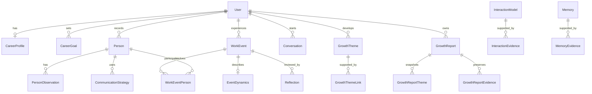

# Career Companion 数据库数据字典（2026-08-27）

> 本文只记录数据库结构和字段含义。结构来源：`prisma/schema.prisma`。当前数据库：PostgreSQL；ORM：Prisma 7。

## 2026-08-28 接入状态更新

- `Conversation` 已由 Chat 页面真实读取和写入，可保存模式、标题、状态、摘要和起止时间。
- `ConversationMessage` 已由 Chat 页面真实读取和写入，可保存角色、正文、模式、模型标识、Prompt 版本和消息顺序。
- 当前助手正文仍由 mock 规则生成，不代表已经接入真实 AI。
- 会话摘要与长期记忆严格分开：结束会话不会自动向 `Memory` 写入数据。

## 2026-08-30 Conversation 删除字段

- `Conversation.deletedAt`：可空时间戳；为空表示正常会话，有值表示用户已删除并从产品界面隐藏。
- 删除时同时将 `Conversation.status` 改为 `DELETED`。
- 当前采用软删除，关联 `ConversationMessage` 暂时保留；后续由保留期限和后台清理任务执行物理删除。

## 1. 阅读说明

- `String @db.Uuid`：PostgreSQL UUID。
- `String @db.Text`：不限制为普通短字符串的长文本。
- `DateTime`：时间戳。
- `Json`：JSON 结构，具体结构由业务层校验。
- 字段类型后的 `?`：允许为空。
- `@default(...)`：数据库或 Prisma 创建记录时的默认值。
- `@updatedAt`：记录更新时由 Prisma自动更新时间。
- `@unique`：唯一约束。
- `@@index`：组合索引，不代表唯一。
- `@@unique`：组合唯一约束。
- `onDelete: Cascade`：父记录删除时子记录一起删除。
- `onDelete: SetNull`：父记录删除后，子记录外键改为空。
- 本文中的“关系字段”是 Prisma 查询导航，不一定是 PostgreSQL 中实际存在的一列。真正落库的是对应的 `xxxId` 外键字段。

## 2. 枚举字典

### 2.1 `ConfirmationStatus`：信息确认状态

| 值 | 含义 |
|---|---|
| `AUTO_RECORDED` | 系统自动记录，尚未经过进一步判断 |
| `PENDING_EVIDENCE` | 当前证据不足，需要继续积累 |
| `PENDING_CONFIRMATION` | 已形成候选结论，等待用户确认 |
| `USER_CONFIRMED` | 用户明确确认 |
| `USER_CORRECTED` | 用户纠正过系统原结论 |
| `USER_REJECTED` | 用户明确否认 |
| `SUPERSEDED` | 已被更新版本替代，保留历史但不再作为当前结论 |

### 2.2 `EvidenceKind`：人物信息/证据类型

| 值 | 含义 |
|---|---|
| `FACT` | 可核实的事实，例如“张经理是项目经理” |
| `OBSERVATION` | 从事件中观察到的行为，不等同于人格事实 |
| `INFERENCE` | 基于证据的推测，必须明确标为推测 |
| `USER_FEELING` | 用户面对该人物时的主观感受 |
| `COMMUNICATION_PREFERENCE` | 对方可能偏好的沟通方式 |
| `EFFECTIVE_STRATEGY` | 已尝试并可能有效的沟通策略 |

### 2.3 `GrowthThemeStatus`：成长主题状态

| 值 | 含义 |
|---|---|
| `EMERGING` | 刚出现的主题候选 |
| `PENDING_CONFIRMATION` | 等待用户确认是否成立 |
| `ACTIVE` | 当前正在练习 |
| `IMPROVING` | 已出现有证据支持的变化 |
| `DORMANT` | 最近没有继续出现或暂时搁置 |
| `RESOLVED` | 用户认为已基本解决或形成稳定方法 |
| `REJECTED` | 用户不认可该主题 |

### 2.4 `GrowthThemeSource`：成长主题来源

| 值 | 含义 |
|---|---|
| `USER_CREATED` | 用户主动创建 |
| `AI_SUGGESTED` | AI 基于证据提出候选 |
| `CO_CREATED` | 用户与教练在对话中共同形成 |
| `REFLECTION_DERIVED` | 从复盘中提取 |

### 2.5 其他枚举

| 枚举 | 值 | 含义 |
|---|---|---|
| `ConversationMode` | `LISTENING`、`COACHING`、`ADVICE`、`ROLEPLAY`、`REFLECTION`、`CAREER`、`SAFETY` | 当前对话采用的陪伴模式 |
| `MessageRole` | `USER`、`ASSISTANT`、`SYSTEM` | 消息发送角色 |
| `EntityStatus` | `ACTIVE`、`ARCHIVED`、`DELETED` | 通用实体状态 |
| `ActionStatus` | `OPEN`、`IN_PROGRESS`、`COMPLETED`、`CANCELLED` | 行动项状态 |
| `ReportPeriod` | `WEEKLY`、`MONTHLY`、`QUARTERLY` | 报告周期 |
| `ReportStatus` | `DRAFT`、`CONFIRMED`、`SUPERSEDED` | 报告草稿、已确认或已被新版本替代 |

## 3. 用户与职业档案

### 3.1 `User`：用户主表

所有私人数据的归属根节点。未来多用户环境中，其他业务表必须通过 `userId` 隔离。

| 字段 | 类型/约束 | 含义 |
|---|---|---|
| `id` | UUID，主键，自动生成 | 用户唯一标识 |
| `email` | String，可空，唯一 | 登录邮箱；当前演示账号为 `demo@career-companion.local` |
| `displayName` | String，必填 | 页面显示名称，例如“七七” |
| `locale` | String，默认 `zh-CN` | 语言与本地化设置 |
| `timezone` | String，默认 `Asia/Shanghai` | 用户时区，用于事件和报告日期 |
| `memoryEnabled` | Boolean，默认 `true` | 是否允许新增长期记忆 |
| `consentVersion` | String，可空 | 用户同意的隐私/数据协议版本 |
| `createdAt` | DateTime，默认当前时间 | 创建时间 |
| `updatedAt` | DateTime，自动更新 | 最近更新时间 |
| `deletedAt` | DateTime，可空 | 软删除时间；为空表示未删除 |
| `careerProfile` | Prisma 一对一关系 | 对应职业档案 |
| `careerGoals` | Prisma 一对多关系 | 用户的职业目标 |
| `growthThemes` | Prisma 一对多关系 | 用户的成长主题 |
| `people` | Prisma 一对多关系 | 用户记录的职场人物 |
| `relationships` | Prisma 一对多关系 | 用户与人物的关系 |
| `conversations` | Prisma 一对多关系 | 陪伴对话 |
| `workEvents` | Prisma 一对多关系 | 真实工作事件 |
| `actionItems` | Prisma 一对多关系 | 下一步行动 |
| `reflections` | Prisma 一对多关系 | 复盘 |
| `roleplaySessions` | Prisma 一对多关系 | 模拟沟通记录 |
| `memories` | Prisma 一对多关系 | 长期记忆 |
| `insights` | Prisma 一对多关系 | 用户洞察 |
| `patterns` | Prisma 一对多关系 | 重复模式 |
| `selfModelEntries` | Prisma 一对多关系 | Self Model 条目 |
| `worldModelEntries` | Prisma 一对多关系 | World Model 条目 |
| `interactionModels` | Prisma 一对多关系 | Interaction Model 条目 |
| `growthReports` | Prisma 一对多关系 | 成长报告 |

### 3.2 `CareerProfile`：职业档案

与 `User` 一对一，保存相对稳定的职业背景。

| 字段 | 类型/约束 | 含义 |
|---|---|---|
| `id` | UUID，主键 | 职业档案 ID |
| `userId` | UUID，唯一，外键 | 所属用户；唯一约束保证一名用户只有一份档案 |
| `currentRole` | String，可空 | 当前岗位，例如“数据分析师” |
| `industry` | String，可空 | 行业，例如“政府数字化 / ToG” |
| `companyType` | String，可空 | 公司类型，例如软件公司、甲方、咨询公司 |
| `companyAlias` | String，可空 | 公司别名，避免记录真实敏感公司名 |
| `city` | String，可空 | 工作城市 |
| `yearsExperience` | Int，可空 | 工作年限 |
| `salaryRangeEncrypted` | String，可空 | 加密后的薪资范围；不能保存明文敏感薪资 |
| `teamName` | String，可空 | 团队名称或别名 |
| `teamSize` | Int，可空 | 团队人数 |
| `managerTitle` | String，可空 | 直属领导职位 |
| `careerStage` | String，可空 | 当前职业阶段描述 |
| `profileCompleteness` | Int，默认 `0` | 档案完整度，0–100；不代表能力评分 |
| `createdAt` | DateTime | 创建时间 |
| `updatedAt` | DateTime，自动更新 | 最近更新时间 |
| `user` | Prisma 关系 | 所属 User；删除用户时级联删除 |

### 3.3 `CareerGoal`：职业目标

| 字段 | 类型/约束 | 含义 |
|---|---|---|
| `id` | UUID，主键 | 目标 ID |
| `userId` | UUID，外键 | 所属用户 |
| `horizon` | String | 时间跨度，例如 `SHORT_TERM`、`MID_TERM`、`LONG_TERM` |
| `title` | String | 目标标题 |
| `description` | String，可空 | 目标补充说明 |
| `status` | String，默认 `ACTIVE` | 目标状态 |
| `targetDate` | DateTime，可空 | 目标日期 |
| `confidence` | Float，可空 | 对目标判断的置信度或明确程度，不是用户能力分数 |
| `createdAt` | DateTime | 创建时间 |
| `updatedAt` | DateTime，自动更新 | 最近更新时间 |
| `user` | Prisma 关系 | 所属 User |

索引：`userId + status`，用于快速查询某用户当前有效目标。

## 4. Growth Theme 与证据

### 4.1 `GrowthTheme`：成长主题

| 字段 | 类型/约束 | 含义 |
|---|---|---|
| `id` | UUID，主键 | 主题 ID |
| `userId` | UUID，外键 | 所属用户 |
| `title` | String | 主题名称，例如“建立责任边界” |
| `description` | Text，可空 | 主题当前定义 |
| `status` | `GrowthThemeStatus`，默认 `EMERGING` | 当前阶段 |
| `source` | `GrowthThemeSource` | 主题形成来源 |
| `originSummary` | Text，可空 | 为什么形成这个主题 |
| `confidence` | Float，可空 | 系统对主题成立程度的置信度 |
| `confirmationStatus` | `ConfirmationStatus` | 用户确认状态 |
| `firstSeenAt` | DateTime | 第一次出现时间 |
| `lastSeenAt` | DateTime | 最近一次被证据支持或讨论的时间 |
| `createdAt` | DateTime | 创建时间 |
| `updatedAt` | DateTime | 最近更新时间 |
| `deletedAt` | DateTime，可空 | 软删除时间 |
| `user` | Prisma 关系 | 所属 User |
| `links` | Prisma 一对多关系 | 主题关联的事件等证据 |
| `reportThemes` | Prisma 一对多关系 | 哪些历史报告快照引用过该主题 |

### 4.2 `GrowthThemeLink`：成长主题证据关联

| 字段 | 类型/约束 | 含义 |
|---|---|---|
| `id` | UUID，主键 | 关联记录 ID |
| `growthThemeId` | UUID，外键 | 对应 Growth Theme |
| `entityType` | String | 证据实体类型，例如 `WORK_EVENT`、`REFLECTION`、`ACTION_ITEM` |
| `entityId` | UUID | 被关联实体 ID |
| `relationType` | String | 关联方式，例如支持主题、显示变化、反例 |
| `evidenceWeight` | Float，可空 | 该证据的参考权重 |
| `createdAt` | DateTime | 创建时间 |
| `growthTheme` | Prisma 关系 | 对应主题 |

组合唯一：同一主题、实体、关系类型不能重复关联。

## 5. Workplace Map：人物与关系

### 5.1 `Person`：职场人物

| 字段 | 类型/约束 | 含义 |
|---|---|---|
| `id` | UUID，主键 | 人物 ID |
| `userId` | UUID，外键 | 人物属于哪位用户的私人职场地图 |
| `displayName` | String | 人物显示名或别名，例如“张经理” |
| `roleTitle` | String，可空 | 人物职位/角色 |
| `groupType` | String，可空 | 分组，例如领导、项目、开发、客户、HR |
| `organizationAlias` | String，可空 | 所属组织别名 |
| `notes` | Text，可空 | 用户主动记录的补充说明 |
| `sensitivityLevel` | String，默认 `NORMAL` | 数据敏感等级 |
| `createdAt` | DateTime | 创建时间 |
| `updatedAt` | DateTime | 最近更新时间 |
| `deletedAt` | DateTime，可空 | 软删除时间 |
| `user` | Prisma 关系 | 所属 User |
| `relationships` | Prisma 关系 | 用户与该人物的关系 |
| `observations` | Prisma 关系 | 事实、观察、推测、感受等 |
| `communicationStrategies` | Prisma 关系 | 沟通策略 |
| `workEventPeople` | Prisma 关系 | 参与过的工作事件 |
| `roleplaySessions` | Prisma 关系 | 以该人物为对象的模拟 |
| `interactionModels` | Prisma 关系 | 与该人物有关的互动模型 |

### 5.2 `Relationship`：用户与人物的关系

| 字段 | 类型/约束 | 含义 |
|---|---|---|
| `id` | UUID，主键 | 关系 ID |
| `userId` | UUID，外键 | 所属用户 |
| `personId` | UUID，外键 | 对应人物 |
| `relationshipType` | String | 关系类型，例如直属领导、项目协作、客户 |
| `closeness` | Int，可空 | 关系接近程度；仅作为布局/检索辅助 |
| `influenceLevel` | Int，可空 | 对用户工作影响程度 |
| `communicationSummary` | Text，可空 | 当前沟通关系概况 |
| `createdAt` | DateTime | 创建时间 |
| `updatedAt` | DateTime | 最近更新时间 |
| `user` | Prisma 关系 | 所属 User |
| `person` | Prisma 关系 | 对应 Person |

组合唯一：同一用户、人物和关系类型只能有一条。

### 5.3 `PersonObservation`：人物信息与判断

| 字段 | 类型/约束 | 含义 |
|---|---|---|
| `id` | UUID，主键 | 观察记录 ID |
| `personId` | UUID，外键 | 对应人物 |
| `kind` | `EvidenceKind` | Fact、Observation、Inference、User Feeling 等类型 |
| `content` | Text | 具体内容 |
| `confidence` | Float，可空 | 判断置信度 |
| `confirmationStatus` | `ConfirmationStatus` | 用户是否确认、纠正或拒绝 |
| `sourceType` | String | 来源类型，例如对话、事件、复盘、用户手工输入 |
| `sourceId` | UUID，可空 | 来源记录 ID |
| `evidenceCount` | Int，默认 `1` | 支持证据数量 |
| `counterEvidenceCount` | Int，默认 `0` | 反例数量 |
| `validFrom` | DateTime，可空 | 结论适用起始时间 |
| `validTo` | DateTime，可空 | 结论失效时间 |
| `createdAt` | DateTime | 创建时间 |
| `updatedAt` | DateTime | 最近更新时间 |
| `deletedAt` | DateTime，可空 | 软删除时间 |
| `person` | Prisma 关系 | 对应 Person |

### 5.4 `CommunicationStrategy`：人物沟通策略

| 字段 | 类型/约束 | 含义 |
|---|---|---|
| `id` | UUID，主键 | 策略 ID |
| `personId` | UUID，外键 | 适用于哪个人物 |
| `context` | Text | 适用情境 |
| `strategy` | Text | 推荐或已验证的沟通做法 |
| `evidenceCount` | Int，默认 `0` | 支持策略有效的真实证据数量 |
| `effectiveness` | Float，可空 | 当前效果估计；不是用户能力评分 |
| `status` | String，默认 `CANDIDATE` | 候选、正在验证、有效、无效等状态 |
| `createdAt` | DateTime | 创建时间 |
| `updatedAt` | DateTime | 最近更新时间 |
| `person` | Prisma 关系 | 对应 Person |

## 6. Companion Chat：对话

### 6.1 `Conversation`：会话

| 字段 | 类型/约束 | 含义 |
|---|---|---|
| `id` | UUID，主键 | 会话 ID |
| `userId` | UUID，外键 | 所属用户 |
| `mode` | `ConversationMode` | 当前/主要陪伴模式 |
| `title` | String，可空 | 会话标题 |
| `status` | `EntityStatus`，默认 `ACTIVE` | 活跃、归档或删除 |
| `summary` | Text，可空 | 会话结束后的摘要 |
| `startedAt` | DateTime | 开始时间 |
| `endedAt` | DateTime，可空 | 结束时间 |
| `createdAt` | DateTime | 创建时间 |
| `updatedAt` | DateTime | 最近更新时间 |
| `user` | Prisma 关系 | 所属 User |
| `messages` | Prisma 关系 | 会话消息列表 |

### 6.2 `ConversationMessage`：会话消息

| 字段 | 类型/约束 | 含义 |
|---|---|---|
| `id` | UUID，主键 | 消息 ID |
| `conversationId` | UUID，外键 | 所属会话 |
| `role` | `MessageRole` | 用户、助手或系统 |
| `content` | Text | 消息正文 |
| `mode` | `ConversationMode`，可空 | 该条消息采用的模式 |
| `model` | String，可空 | 生成消息所用模型 |
| `promptVersion` | String，可空 | Prompt 版本 |
| `tokenUsage` | Json，可空 | Token 用量信息 |
| `safetyLevel` | String，可空 | 安全判断级别 |
| `sequenceNo` | Int | 在会话中的顺序号 |
| `createdAt` | DateTime | 创建时间 |
| `conversation` | Prisma 关系 | 所属 Conversation |
| `memoryEvidence` | Prisma 关系 | 哪些长期记忆引用了该消息 |

组合唯一：同一会话内 `sequenceNo` 不可重复。

## 7. 真实事件、行动与复盘

### 7.1 `WorkEvent`：真实工作事件

| 字段 | 类型/约束 | 含义 |
|---|---|---|
| `id` | UUID，主键 | 事件 ID |
| `userId` | UUID，外键 | 所属用户 |
| `title` | String | 事件标题 |
| `occurredAt` | DateTime | 真实发生时间 |
| `eventType` | String | 事件类型，例如被催进度、需求变更、跨部门协作 |
| `facts` | Text | 已确认的事实经过 |
| `userInterpretation` | Text，可空 | 用户对事件的理解；与事实分开 |
| `emotion` | String，可空 | 用户情绪 |
| `concern` | Text，可空 | 用户真正担心或在意的内容 |
| `outcome` | Text，可空 | 事件结果 |
| `importance` | Int，默认 `1` | 事件重要度，用于检索排序 |
| `createdAt` | DateTime | 创建时间 |
| `updatedAt` | DateTime | 最近更新时间 |
| `deletedAt` | DateTime，可空 | 软删除时间 |
| `user` | Prisma 关系 | 所属 User |
| `dynamics` | Prisma 一对一关系 | 事件互动过程 |
| `people` | Prisma 多对多关系 | 事件参与人物 |
| `reflections` | Prisma 一对多关系 | 该事件的复盘 |

### 7.2 `EventDynamics`：事件互动过程

| 字段 | 类型/约束 | 含义 |
|---|---|---|
| `id` | UUID，主键 | Dynamics ID |
| `workEventId` | UUID，唯一，外键 | 对应事件；一件事只有一份 Dynamics |
| `triggerType` | String，可空 | 触发类型，例如紧急催促、范围变化 |
| `perceivedPressure` | String，可空 | 用户感受到的压力 |
| `userNeed` | String，可空 | 用户当时的核心需要 |
| `userResponse` | Text，可空 | 用户的实际反应 |
| `otherResponse` | Text，可空 | 对方的实际反应 |
| `outcomeCode` | String，可空 | 结构化结果标签 |
| `createdAt` | DateTime | 创建时间 |
| `updatedAt` | DateTime | 最近更新时间 |
| `workEvent` | Prisma 关系 | 对应 WorkEvent |

### 7.3 `WorkEventPerson`：事件参与人物关联

| 字段 | 类型/约束 | 含义 |
|---|---|---|
| `workEventId` | UUID，联合主键、外键 | 工作事件 ID |
| `personId` | UUID，联合主键、外键 | 人物 ID |
| `roleInEvent` | String，可空 | 该人物在事件中的角色 |
| `workEvent` | Prisma 关系 | 对应事件 |
| `person` | Prisma 关系 | 对应人物 |

`workEventId + personId` 为联合主键，避免同一人物被重复加入同一事件。

### 7.4 `ActionItem`：下一步行动

| 字段 | 类型/约束 | 含义 |
|---|---|---|
| `id` | UUID，主键 | 行动项 ID |
| `userId` | UUID，外键 | 所属用户 |
| `sourceType` | String，可空 | 来源类型，例如对话、复盘、成长主题 |
| `sourceId` | UUID，可空 | 来源实体 ID |
| `description` | Text | 要执行的具体行动 |
| `dueAt` | DateTime，可空 | 计划完成时间 |
| `status` | `ActionStatus`，默认 `OPEN` | 当前行动状态 |
| `resultNote` | Text，可空 | 执行后的结果说明 |
| `createdAt` | DateTime | 创建时间 |
| `updatedAt` | DateTime | 最近更新时间 |
| `user` | Prisma 关系 | 所属 User |

### 7.5 `Reflection`：真实事件复盘

| 字段 | 类型/约束 | 含义 |
|---|---|---|
| `id` | UUID，主键 | 复盘 ID |
| `userId` | UUID，外键 | 所属用户 |
| `workEventId` | UUID，可空，外键 | 关联事件；事件删除后设为空并保留复盘 |
| `goalSelf` | Text，可空 | 用户自己的目标 |
| `goalOther` | Text，可空 | 对方可能的目标 |
| `whatHappened` | Text | 实际发生了什么 |
| `workedWell` | Text，可空 | 具体做得好的地方 |
| `improvements` | Text，可空 | 可以改进的具体地方 |
| `nextExperiment` | Text，可空 | 下次准备尝试的一个动作 |
| `createdAt` | DateTime | 创建时间 |
| `updatedAt` | DateTime | 最近更新时间 |
| `user` | Prisma 关系 | 所属 User |
| `workEvent` | Prisma 关系，可空 | 对应 WorkEvent |

## 8. Role Play：模拟沟通

### 8.1 `RoleplaySession`：模拟会话

| 字段 | 类型/约束 | 含义 |
|---|---|---|
| `id` | UUID，主键 | 模拟 ID |
| `userId` | UUID，外键 | 所属用户 |
| `personId` | UUID，可空，外键 | 模拟的真实人物；也可使用通用角色而不关联人物 |
| `roleTemplate` | String | 对方角色模板 |
| `scenario` | Text | 模拟场景 |
| `personaStyle` | String，可空 | 对方沟通风格 |
| `difficulty` | String | 难度 |
| `userGoal` | Text | 用户此次练习目标 |
| `status` | `EntityStatus`，默认 `ACTIVE` | 模拟状态 |
| `reviewJson` | Json，可空 | 模拟结束后的结构化复盘 |
| `createdAt` | DateTime | 创建时间 |
| `updatedAt` | DateTime | 最近更新时间 |
| `user` | Prisma 关系 | 所属 User |
| `person` | Prisma 关系，可空 | 对应 Person |
| `messages` | Prisma 关系 | 模拟消息 |

### 8.2 `RoleplayMessage`：模拟消息

| 字段 | 类型/约束 | 含义 |
|---|---|---|
| `id` | UUID，主键 | 消息 ID |
| `sessionId` | UUID，外键 | 所属模拟会话 |
| `role` | `MessageRole` | 用户、模拟角色或系统 |
| `content` | Text | 消息正文 |
| `sequenceNo` | Int | 消息顺序 |
| `feedbackTags` | Json，可空 | 与具体表达相关的反馈标签 |
| `createdAt` | DateTime | 创建时间 |
| `session` | Prisma 关系 | 对应 RoleplaySession |

组合唯一：同一模拟会话中 `sequenceNo` 不可重复。

## 9. Memory：长期记忆

### 9.1 `Memory`：长期记忆主表

| 字段 | 类型/约束 | 含义 |
|---|---|---|
| `id` | UUID，主键 | 记忆 ID |
| `userId` | UUID，外键 | 所属用户 |
| `type` | String | 记忆类型，例如人物、事件、偏好、目标 |
| `canonicalText` | Text | 当前规范化表述 |
| `structuredData` | Json，可空 | 可供程序使用的结构化内容 |
| `certainty` | String | 信息确定性，例如事实、观察、推测 |
| `confidence` | Float，可空 | 系统置信度 |
| `importance` | Int，默认 `1` | 检索重要度 |
| `sensitivity` | String，默认 `NORMAL` | 敏感级别 |
| `confirmationStatus` | `ConfirmationStatus` | 用户确认状态 |
| `validFrom` | DateTime，可空 | 有效起始时间 |
| `validTo` | DateTime，可空 | 有效结束时间 |
| `status` | `EntityStatus`，默认 `ACTIVE` | 当前状态 |
| `version` | Int，默认 `1` | 记忆版本 |
| `createdAt` | DateTime | 创建时间 |
| `updatedAt` | DateTime | 最近更新时间 |
| `deletedAt` | DateTime，可空 | 软删除时间 |
| `user` | Prisma 关系 | 所属 User |
| `evidence` | Prisma 关系 | 支持该记忆的来源证据 |
| `links` | Prisma 关系 | 与人物、事件等实体的关联 |

### 9.2 `MemoryEvidence`：记忆证据

| 字段 | 类型/约束 | 含义 |
|---|---|---|
| `id` | UUID，主键 | 证据 ID |
| `memoryId` | UUID，外键 | 对应 Memory |
| `messageId` | UUID，可空，外键 | 来源消息；消息删除后设为空 |
| `sourceType` | String | 来源实体类型 |
| `sourceId` | UUID | 来源实体 ID |
| `excerptHash` | String，可空 | 来源片段摘要值，用于去重/审计，避免复制敏感全文 |
| `evidenceWeight` | Float，可空 | 证据权重 |
| `createdAt` | DateTime | 创建时间 |
| `memory` | Prisma 关系 | 对应 Memory |
| `message` | Prisma 关系，可空 | 对应 ConversationMessage |

组合唯一：同一记忆不能重复引用同一来源。

### 9.3 `MemoryLink`：记忆实体关联

| 字段 | 类型/约束 | 含义 |
|---|---|---|
| `id` | UUID，主键 | 关联 ID |
| `memoryId` | UUID，外键 | 对应 Memory |
| `entityType` | String | 被关联实体类型 |
| `entityId` | UUID | 被关联实体 ID |
| `relationType` | String | 关联方式 |
| `memory` | Prisma 关系 | 对应 Memory |

## 10. Insight 与重复模式

### 10.1 `UserInsight`：用户洞察

| 字段 | 类型/约束 | 含义 |
|---|---|---|
| `id` | UUID，主键 | 洞察 ID |
| `userId` | UUID，外键 | 所属用户 |
| `type` | String | 洞察类型，例如优势、压力源、变化 |
| `title` | String | 洞察标题 |
| `summary` | Text | 洞察内容 |
| `confidence` | Float，可空 | 洞察置信度 |
| `confirmationStatus` | `ConfirmationStatus` | 用户确认状态 |
| `firstSeenAt` | DateTime | 第一次出现 |
| `lastSeenAt` | DateTime | 最近一次被证据支持 |
| `status` | `EntityStatus`，默认 `ACTIVE` | 当前状态 |
| `createdAt` | DateTime | 创建时间 |
| `updatedAt` | DateTime | 最近更新时间 |
| `user` | Prisma 关系 | 所属 User |
| `evidence` | Prisma 关系 | 支持洞察的证据 |

### 10.2 `InsightEvidence`：洞察证据

| 字段 | 类型/约束 | 含义 |
|---|---|---|
| `id` | UUID，主键 | 证据 ID |
| `insightId` | UUID，外键 | 对应 UserInsight |
| `sourceType` | String | 来源类型 |
| `sourceId` | UUID | 来源实体 ID |
| `evidenceNote` | Text | 为什么该来源支持此洞察 |
| `weight` | Float，可空 | 证据权重 |
| `occurredAt` | DateTime，可空 | 证据发生时间 |
| `insight` | Prisma 关系 | 对应 UserInsight |

### 10.3 `UserPattern`：重复模式

| 字段 | 类型/约束 | 含义 |
|---|---|---|
| `id` | UUID，主键 | 模式 ID |
| `userId` | UUID，外键 | 所属用户 |
| `triggerSignature` | Json | 常见触发条件结构 |
| `responseSignature` | Json | 用户典型反应结构 |
| `outcomeSignature` | Json，可空 | 常见结果结构 |
| `confidence` | Float，可空 | 模式置信度 |
| `eventCount` | Int，默认 `0` | 支持事件数量 |
| `counterexampleCount` | Int，默认 `0` | 反例数量 |
| `confirmationStatus` | `ConfirmationStatus` | 用户确认状态 |
| `status` | String，默认 `CANDIDATE` | 候选、已确认、拒绝、替代等业务状态 |
| `createdAt` | DateTime | 创建时间 |
| `updatedAt` | DateTime | 最近更新时间 |
| `user` | Prisma 关系 | 所属 User |

## 11. Self / World / Interaction 三个长期模型

### 11.1 `SelfModelEntry`：用户自我模型条目

| 字段 | 类型/约束 | 含义 |
|---|---|---|
| `id` | UUID，主键 | 条目 ID |
| `userId` | UUID，外键 | 所属用户 |
| `category` | String | 类别，例如 strength、value、need、stressor、work_style、aspiration |
| `statement` | Text | 当前表述 |
| `certainty` | String | 事实、观察、推测等确定性 |
| `confidence` | Float，可空 | 置信度 |
| `evidenceCount` | Int，默认 `0` | 支持证据数量 |
| `confirmationStatus` | `ConfirmationStatus` | 用户确认状态 |
| `validFrom` | DateTime，可空 | 当前版本开始有效时间 |
| `validTo` | DateTime，可空 | 当前版本结束有效时间 |
| `version` | Int，默认 `1` | 版本号 |
| `createdAt` | DateTime | 创建时间 |
| `updatedAt` | DateTime | 最近更新时间 |
| `user` | Prisma 关系 | 所属 User |

### 11.2 `WorldModelEntry`：用户职场世界模型条目

| 字段 | 类型/约束 | 含义 |
|---|---|---|
| `id` | UUID，主键 | 条目 ID |
| `userId` | UUID，外键 | 所属用户 |
| `entityType` | String | 公司、团队、项目、人物、约束、风险、事件等 |
| `entityId` | UUID，可空 | 对应具体业务实体 ID |
| `statement` | Text | 当前世界模型表述 |
| `certainty` | String | 信息确定性 |
| `confidence` | Float，可空 | 置信度 |
| `evidenceCount` | Int，默认 `0` | 支持证据数量 |
| `validFrom` | DateTime，可空 | 生效时间 |
| `validTo` | DateTime，可空 | 失效时间 |
| `version` | Int，默认 `1` | 版本号 |
| `createdAt` | DateTime | 创建时间 |
| `updatedAt` | DateTime | 最近更新时间 |
| `user` | Prisma 关系 | 所属 User |

### 11.3 `InteractionModel`：用户与人物/环境的互动模型

| 字段 | 类型/约束 | 含义 |
|---|---|---|
| `id` | UUID，主键 | 模型 ID |
| `userId` | UUID，外键 | 所属用户 |
| `personId` | UUID，可空，外键 | 特定人物；为空时可描述一类环境 |
| `environmentType` | String，可空 | 场景类型，例如被催进度、需求变更 |
| `triggerSignature` | Json | 典型触发条件 |
| `typicalInternalResponse` | Text，可空 | 用户常见心理反应 |
| `typicalBehavior` | Text，可空 | 用户常见实际行为 |
| `typicalOutcome` | Text，可空 | 常见结果 |
| `effectiveStrategy` | Text，可空 | 有证据支持的有效策略 |
| `confidence` | Float，可空 | 模型置信度 |
| `status` | String，默认 `CANDIDATE` | 候选、用户确认、被替代等状态 |
| `version` | Int，默认 `1` | 版本号 |
| `createdAt` | DateTime | 创建时间 |
| `updatedAt` | DateTime | 最近更新时间 |
| `user` | Prisma 关系 | 所属 User |
| `person` | Prisma 关系，可空 | 对应 Person；人物删除后设为空 |
| `evidence` | Prisma 关系 | 模型证据 |

### 11.4 `InteractionEvidence`：互动模型证据

| 字段 | 类型/约束 | 含义 |
|---|---|---|
| `id` | UUID，主键 | 证据 ID |
| `interactionModelId` | UUID，外键 | 对应 InteractionModel |
| `sourceType` | String | 来源类型，例如事件、复盘、模拟、行动 |
| `sourceId` | UUID | 来源实体 ID |
| `observedChange` | Text，可空 | 该证据显示出的行为变化 |
| `evidenceWeight` | Float，可空 | 证据权重 |
| `occurredAt` | DateTime，可空 | 证据发生时间 |
| `interactionModel` | Prisma 关系 | 对应模型 |

组合唯一：同一互动模型不能重复引用同一来源。

## 12. Growth Report：成长报告快照

### 12.1 `GrowthReport`：报告主表

| 字段 | 类型/约束 | 含义 |
|---|---|---|
| `id` | UUID，主键 | 报告 ID |
| `userId` | UUID，外键 | 所属用户 |
| `periodType` | `ReportPeriod` | 周报、月报或季度回顾 |
| `periodStart` | DateTime | 报告周期开始 |
| `periodEnd` | DateTime | 报告周期结束 |
| `status` | `ReportStatus`，默认 `DRAFT` | 草稿、确认或被替代 |
| `summarySnapshot` | Text | 生成/确认报告时的总结快照 |
| `nextFocusSnapshot` | Text，可空 | 当时确定的下一阶段重点快照 |
| `generatedAt` | DateTime | 报告生成时间 |
| `confirmedAt` | DateTime，可空 | 用户确认时间 |
| `version` | Int，默认 `1` | 同一周期的报告版本 |
| `createdAt` | DateTime | 创建时间 |
| `updatedAt` | DateTime | 最近更新时间 |
| `user` | Prisma 关系 | 所属 User |
| `themes` | Prisma 关系 | 报告中的主题快照 |
| `evidence` | Prisma 关系 | 报告采用的证据快照 |

组合唯一：同一用户、周期类型、起止日期和版本不可重复。

### 12.2 `GrowthReportTheme`：报告主题快照

| 字段 | 类型/约束 | 含义 |
|---|---|---|
| `id` | UUID，主键 | 快照 ID |
| `reportId` | UUID，外键 | 所属报告 |
| `growthThemeId` | UUID，可空，外键 | 原始 Growth Theme；主题删除后可为空，快照仍保留 |
| `themeTitleSnapshot` | String | 当时的主题标题 |
| `themeStatusSnapshot` | String | 当时的主题状态 |
| `pastPatternSnapshot` | Text，可空 | 当时总结的过去反应方式 |
| `recentPatternSnapshot` | Text，可空 | 当时总结的最近反应方式 |
| `effectiveStrategySnapshot` | Text，可空 | 当时确认的有效策略 |
| `nextExperimentSnapshot` | Text，可空 | 当时决定的下一步实验 |
| `report` | Prisma 关系 | 所属 GrowthReport |
| `growthTheme` | Prisma 关系，可空 | 原始 GrowthTheme |
| `evidence` | Prisma 关系 | 支持该主题快照的证据 |

### 12.3 `GrowthReportEvidence`：报告证据快照

| 字段 | 类型/约束 | 含义 |
|---|---|---|
| `id` | UUID，主键 | 快照证据 ID |
| `reportId` | UUID，外键 | 所属报告 |
| `reportThemeId` | UUID，可空，外键 | 可选地归属某个报告主题 |
| `sourceType` | String | 原始证据类型 |
| `sourceId` | UUID | 原始证据 ID |
| `evidenceSnapshot` | Text | 报告生成时保存的证据文字快照 |
| `occurredAt` | DateTime | 原始证据发生时间 |
| `report` | Prisma 关系 | 所属 GrowthReport |
| `reportTheme` | Prisma 关系，可空 | 对应 GrowthReportTheme |

快照字段不能随着当前 Growth Theme 或原始事件的后续编辑自动覆盖。修改正式历史报告时，应创建新版本，并将旧版本标记为 `SUPERSEDED`。

## 13. 数据关系总览

## 14. DBeaver 中容易困惑的地方

1. Prisma Model 名称当前使用首字母大写，因此 PostgreSQL 中可能显示为带双引号的表名，例如 `"User"`、`"GrowthTheme"`。
2. `user`、`people`、`themes` 等 Prisma 关系字段不是数据库实际列；DBeaver 中应查看 `userId`、`personId`、`reportId` 等外键。
3. 修改数据后需要提交事务；如果关闭了自动提交，要点击 DBeaver 的 Commit。
4. 修改 `User.displayName` 只会影响已经读取该字段的页面；仍使用 mock data 的页面不会自动变化。
5. 不要直接删除作为外键父节点的记录，`Cascade` 可能连带删除大量子数据。
6. 不要随意运行 Seed；当前 Seed 会删除并重建演示用户及其关联数据。
7. 正式业务写入应通过应用的 Repository / Service / Server Action，并始终限定当前 `userId`，DBeaver 仅用于本地检查和调试。

## 15. 当前接入状态

| 数据区域 | Schema | Seed | 页面读取 | 页面写入 |
|---|---:|---:|---:|---:|
| User 姓名 | 已有 | 已有 | Home、My Career、Growth、Settings | My Career 可修改 |
| CareerProfile | 已有 | 已有 | My Career 已读取 | My Career 可编辑保存 |
| CareerGoal | 已有 | 视 Seed 数据 | My Career 已读取 | My Career 可编辑保存 |
| Person / Relationship | 已有 | 已有人物 | Workplace Map 已读取 | Workplace Map 可新增、编辑和软删除人物 |
| WorkEvent / Dynamics | 已有 | 已有 | Growth 时间轴、Workplace Map 近期事件已读取 | 暂无 |
| GrowthTheme | 已有 | 已有 | Growth 已读取 | 暂无 |
| GrowthReport 快照 | 已有 | 已有 | Growth 已读取 | 暂无 |
| Conversation | 已有 | 暂未作为真实聊天使用 | Chat 为 mock | 暂无 |
| Reflection / Roleplay | 已有 | 演示结构 | 页面为 mock | 暂无 |
| Memory | 已有 | 当前真实空状态 | Settings 已读取 | 可切换记忆开关、手动新增、确认、纠正、拒绝和软删除 |
| Models / Insight | 已有 | 部分演示 | Self Model 仅展示已确认数据 | 暂无自动生成 |

本文档应在每次 Prisma Schema 发生 Migration 后同步更新。
