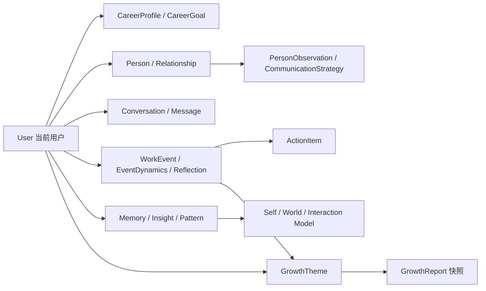

# Career Companion 项目开发总记录（截至 2026-09-25）

> 更新日期：2026-09-25。本文依据当前源码、专题记录与本地 Git 历史整理，涵盖从 Clickable MVP Shell 到聊天历史隐私设置的开发内容。所有实现以项目根目录的 `PRODUCT_ARCHITECTURE.md` 为总规范。本次是文档汇总更新，不表示今天新增了下述全部功能。

> 2026-08-30 新增下一阶段记录：`docs/NEXT_PHASE_CHAT_RETENTION_AND_PRIVACY_20260830.md`。在记忆候选自动提取之前，先补齐单次会话删除、清空历史、历史保存开关、临时对话、自动过期和数据导出。

## 2026-08-28 增量：Companion Chat 数据闭环

- Chat 已从静态 mock 页面升级为 PostgreSQL 会话与消息读写。
- 支持新建会话、四种陪伴模式、历史切换、刷新恢复和结束归档。
- 结束会话会写入规则生成的 `Conversation.summary`，但不会直接创建长期记忆。
- 助手回复暂时仍为 mock；数据库会保存 `model = mock` 和 `promptVersion = mock-chat-v1`。
- 后续顺序已调整为先补齐会话隐私管理，再进行记忆候选提取；见第 9 节。
- 详细测试见 `docs/CHAT_DATABASE_TEST_20260828.md`。

## 1. 当前阶段结论

2026-09-20：完成“保存聊天历史”开关，Settings 与 Chat 同步读取用户设置。关闭后新消息仅保留当前页面，不入库；详细行为和测试见 `docs/CHAT_HISTORY_SETTING_20260920.md`。

项目已经从纯 Clickable MVP Shell 进入“逐页接入真实数据库”的阶段，但还没有接入真实 AI、登录鉴权、RAG 或长期记忆自动提取。

目前已经完成：

- Next.js App Router + React + TypeScript + Tailwind CSS 的产品骨架。
- Home、Chat、My Career、Workplace Map、Role Play、Reflection、Growth、Settings 八个页面。
- 本机 PostgreSQL 18 与 DBeaver 安装、连接和数据库创建。
- Prisma 7 数据模型、首个 Migration、Seed 演示数据与数据库校验脚本。
- Growth 页面改为读取 PostgreSQL 实时数据。
- Home、My Career、Growth、Settings 通过同一个“当前用户”入口读取姓名。
- My Career 已完成 CareerProfile、CareerGoal、GrowthTheme 的数据库读取，并可通过编辑抽屉写回数据库。
- Workplace Map 已完成 Person、Relationship、PersonObservation、CommunicationStrategy、WorkEvent 的数据库读取，并支持人物维护和推测审核。
- Settings 已完成 User.memoryEnabled、Memory、MemoryEvidence、MemoryLink 的数据库读取与用户可控管理。
- Growth Report 使用快照表保存历史版本，避免模型或主题更新后覆盖过去的结论。
- Chat 会话与消息已入库，支持四种陪伴模式、历史切换、结束会话和规则摘要。
- 聊天正文独立滚动，左侧历史支持折叠；重复的右侧历史入口与抽屉已删除。
- 支持单次会话删除和输入“清空”确认后的全部历史清空，均为当前用户范围内的软删除。
- Settings 已增加 `User.chatHistoryEnabled` 开关，Chat 服务端实际执行保存策略。
- PostgreSQL 表与字段已加中文注释，新增迁移同步补注释。
- 已建立本地 Git 基线及 `codex/chat-database` 功能分支，逐步提交可回退版本。

当前仍是混合状态：

- 用户资料、职业档案、职场人物、Growth 展示数据和 Settings 记忆来自数据库；其中部分数据由 Seed 演示数据初始化，不代表 AI 自动生成。
- Chat 在开启历史保存时读写真实会话与消息，助手回复仍是 mock，摘要由规则生成。
- Home 最近关注等内容、Role Play 和 Reflection 主要仍为演示内容；尚未形成完整真实事件写入闭环。
- 当前没有登录系统，暂时将 `demo@career-companion.local` 视为当前用户。

## 2. 技术栈与本地环境

| 层级 | 当前实现 |
|---|---|
| Web | Next.js 15 App Router、React 19、TypeScript |
| UI | Tailwind CSS 4、shadcn/ui 风格基础组件、Lucide Icons |
| 数据库 | PostgreSQL 18（本机） |
| 数据库客户端 | DBeaver |
| ORM | Prisma 7.10、`@prisma/adapter-pg`、`pg` |
| 数据库配置 | 根目录 `.env` 中的 `DATABASE_URL`（已被 Git 忽略） |
| 演示账号 | `demo@career-companion.local` |

常用命令：

```bash
npm run dev
npm run lint
npm run build
npm run db:validate
npm run db:generate
npm run db:migrate
npm run db:seed
npm run db:verify
npm run db:studio
npm run db:verify-comments
npm run db:verify-memory-write
npm run db:verify-chat-write
npm run db:verify-chat-clear
npx tsx scripts/verify-chat-history-setting.ts
```

注意：数据库密码只保存在 `.env`，文档、代码和 Git 中都不要记录真实密码。

## 3. 数据库落地过程

### 3.1 本地数据库

在 PostgreSQL 中创建了：

```text
career_companion
```

DBeaver 已能连接并查看表与数据。

### 3.2 Prisma 初始化

核心文件：

- `prisma/schema.prisma`：数据结构总定义。
- `prisma/migrations/20260827003421_init/migration.sql`：首个数据库迁移。
- `prisma/seed.ts`：真实职场场景演示数据。
- `scripts/verify-database.ts`：校验演示用户、人物证据类型、Growth Theme 和报告数据。
- `src/server/db/prisma.ts`：应用内部复用的 Prisma Client。

迁移、Seed 和校验均已成功执行。

### 3.3 当前演示数据

Seed 建立的主要数据包括：

- 1 个演示用户。
- 1 份职业档案。
- 3 个职场人物。
- 4 个真实风格的工作事件。
- 2 个 Growth Theme。
- 1 个已确认的 Interaction Model。
- 3 个月度成长报告，其中历史月份为已确认快照，当前月份为草稿。

用户后来在 DBeaver 中将 `User.displayName` 从“林然”修改为“七七”，数据库已验证保存成功。

重要提醒：当前 `prisma/seed.ts` 会先删除旧的演示用户，再重新创建。如果再次运行 `npm run db:seed`，手工修改过的“七七”可能被 Seed 默认值覆盖。Seed 只适合重置演示环境，不应作为日常修改数据的方式。

## 4. 数据库整体结构

当前 Schema 包含 31 个 Model，可按业务含义分为八组。



### 4.1 用户与职业档案

| 表 | 用途 | 关键字段 |
|---|---|---|
| `User` | 用户主表、隐私设置和所有个人数据的归属根节点 | `email`、`displayName`、`locale`、`timezone`、`memoryEnabled`、`chatHistoryEnabled` |
| `CareerProfile` | 相对稳定的职业背景；与 User 一对一 | `currentRole`、`industry`、`companyType`、`city`、`yearsExperience`、`careerStage` |
| `CareerGoal` | 短期、中期、长期职业目标；与 User 一对多 | `horizon`、`title`、`status`、`targetDate`、`confidence` |

设计考虑：用户姓名与账号属性放在 `User`；职业背景放在 `CareerProfile`，避免把所有内容都堆到用户主表。

### 4.2 职场人物与关系

| 表 | 用途 |
|---|---|
| `Person` | 用户职场世界中的领导、项目经理、同事、客户、HR 等人物 |
| `Relationship` | 用户与人物的关系类型、亲近度、影响力和沟通概况 |
| `PersonObservation` | 对人物的事实、观察、推测和用户感受 |
| `CommunicationStrategy` | 与某个人在特定情境下可能有效的沟通策略 |

`PersonObservation.kind` 必须明确区分：

- `FACT`：可核实事实。
- `OBSERVATION`：用户观察到的重复行为。
- `INFERENCE`：AI 或用户基于证据作出的推测。
- `USER_FEELING`：用户面对这个人物时的主观感受。

每条观察还保存 `confirmationStatus`、`confidence`、`sourceType/sourceId`、正反证据数量。这样 AI 可以主动提取候选信息，但不能未经确认把推测表现成事实。

### 4.3 对话

| 表 | 用途 |
|---|---|
| `Conversation` | 一次陪伴对话的会话信息、模式、状态和摘要 |
| `ConversationMessage` | 按顺序保存用户和助手消息，并预留模型、Prompt 版本、Token 和安全级别信息 |

历史保存开启时，两张表已接入真实读写。`Conversation.summary` 保存规则生成的摘要，`ConversationMessage` 保存消息角色、正文、模式、顺序和时间；mock 助手回复记录 `model = mock`、`promptVersion = mock-chat-v1`。历史列表当前读取最近 20 条会话，尚未提供分页入口。

删除单次会话或清空历史会设置 `Conversation.deletedAt` 与 `status = DELETED`，查询排除这些会话。消息仍在数据库中；自动物理清理尚未实现，也没有前端恢复入口。

`User.chatHistoryEnabled` 默认 true。关闭后新对话不写入会话、消息或长期记忆表，只保留在当前页面 React 状态中；刷新、离开、切换历史或开始新对话后丢失。已有历史仍保留，关闭期间禁止追加消息，重新开启后可继续。服务端每次发送检查设置，当前页面内对话不会因重新开启开关而自动入库。

### 4.4 事件、行动、模拟与复盘

| 表 | 用途 |
|---|---|
| `WorkEvent` | 一次有时间、事实、情绪、关注点和结果的真实职场事件 |
| `EventDynamics` | 事件中的触发、压力、用户需要、双方反应和结果模式 |
| `WorkEventPerson` | 事件与参与人物的多对多关联 |
| `ActionItem` | 从对话、事件或复盘产生的下一步行动 |
| `Reflection` | 对真实事件的目标、经过、有效动作、改进点和下一次实验 |
| `RoleplaySession` | 模拟沟通的场景、难度、目标、角色和复盘结果 |
| `RoleplayMessage` | 一轮模拟中的逐条消息 |

设计考虑：真实发生的事件与模拟练习必须分开。只有真实行动和后续复盘才能作为成长的强证据，不能把“模拟得不错”直接算作现实成长。

### 4.5 长期记忆与洞察

| 表 | 用途 |
|---|---|
| `Memory` | 可查看、可确认、可删除、带版本的长期记忆 |
| `MemoryEvidence` | 记忆来自哪条消息或哪项业务实体 |
| `MemoryLink` | 记忆与人物、事件、主题等实体的关联 |
| `UserInsight` / `InsightEvidence` | 基于多项证据形成的洞察及证据 |
| `UserPattern` | 触发 → 反应 → 结果的重复模式候选 |

Settings 已读取真实 `Memory`、`MemoryEvidence` 和 `MemoryLink`，支持手动添加、确认、纠正、拒绝及软删除。手动添加的记忆标记为用户确认。证据与关联区域显示数据库已有内容；手动记忆没有聊天证据时会明确说明。

`User.memoryEnabled` 控制长期记忆设置，与聊天历史开关是两个独立字段。自动提取器尚未接入，所以开启长期记忆后聊天不会自动新增 Memory。`UserInsight`、`UserPattern` 和模型自动更新目前主要是结构预留；聊天摘要也不等于长期记忆。

### 4.6 三个长期模型

| 表 | 回答的问题 |
|---|---|
| `SelfModelEntry` | “我是怎样工作和成长的人？”包括优势、需要、压力源、偏好、方向等 |
| `WorldModelEntry` | “我所在的职场世界是什么样？”包括公司、团队、项目、人物、约束和风险 |
| `InteractionModel` / `InteractionEvidence` | “我与某个人或环境相遇时，通常怎样反应，什么策略更有效？” |

三类模型都是基于证据的投影，不替代原始事件，也不能直接覆盖成“用户事实”。它们包含置信度、状态、版本和证据关系。

### 4.7 Growth Theme

| 表 | 用途 |
|---|---|
| `GrowthTheme` | 用户正在持续练习和改变的主题 |
| `GrowthThemeLink` | 主题与工作事件等真实证据的关联 |

主题保存：

- 为什么形成：`originSummary`
- 来源：`source`
- 用户确认状态：`confirmationStatus`
- 当前状态：`status`
- 置信度与首次/最近出现时间
- 关联事件数量和权重

当前 Seed 的示例主题包括“建立责任边界”和“把依赖说清楚”。这些是演示用的共创/复盘主题，不代表未来由系统无条件替用户决定。

### 4.8 成长报告与历史快照

| 表 | 用途 |
|---|---|
| `GrowthReport` | 周报、月报或季度回顾的版本、状态、总结和下一阶段重点 |
| `GrowthReportTheme` | 报告生成当时的主题、过去模式、最近模式、有效策略和下一次实验快照 |
| `GrowthReportEvidence` | 报告当时采用的真实事件证据文本快照 |

报告采用 Snapshot，而不是每次打开时根据最新 Theme 临时重算。即使几个月后 AI 或用户修改了当前理解，8 月报告仍然保留 8 月确认时的结论；新结论通过新版本或新月份报告表达。

这支持产品希望呈现的变化链：

```text
8 月：被催 → 焦虑 → 马上答应
  ↓
9 月：开始说明依赖，但仍会同时承诺冲突任务
  ↓
10 月：先澄清优先级 → 说明依赖 → 给出时间节点
```

## 5. 关键状态枚举

当前 Schema 中有 10 组枚举，主要用于避免重要业务状态被任意字符串污染：

- `ConfirmationStatus`：信息是否已被用户确认、拒绝或仍缺证据。
- `EvidenceKind`：Fact、Observation、Inference、User Feeling。
- `GrowthThemeStatus`：主题处于萌芽、活跃、改善、稳定等阶段。
- `GrowthThemeSource`：主题来自用户、对话共创、复盘或系统候选等来源。
- `ConversationMode`：倾听、教练、建议、模拟、复盘、职业与安全模式。
- `MessageRole`：消息角色。
- `EntityStatus`：通用实体状态。
- `ActionStatus`：行动项状态。
- `ReportPeriod`：周、月、季度。
- `ReportStatus`：草稿、确认、被新版本替代。

## 6. 页面目前如何读取数据库

### 6.1 当前用户统一入口

新增：

```text
src/server/repositories/current-user-repository.ts
```

各页面通过统一的演示邮箱常量识别同一个用户；Home 使用身份查询函数，其他功能 repository 按需读取同一用户及业务数据。当前逻辑是按以下邮箱查找：

```text
demo@career-companion.local
```

因此把数据库中的 `User.displayName` 改为“七七”后，这四个页面都会显示“七七”。

这是 MVP 过渡方案，不是最终鉴权方案。以后接入登录后，应在这个 repository 中改为从 Session 取得 `userId`，所有 repository 查询继续强制带 `userId`，页面不需要各自重新实现用户识别。

### 6.2 Growth Repository

```text
src/server/repositories/growth-repository.ts
```

它负责：

- 查询当前用户与 Growth Theme。
- 从 `GrowthThemeLink` 找到关联 `WorkEvent`。
- 加载事件人物和 Event Dynamics。
- 加载 Growth Report、主题快照和证据快照。
- 转换为 Growth 页面所需的 View Model。

Growth Route 使用 `dynamic = "force-dynamic"`，因此刷新页面会重新读取数据库，而不是继续显示构建时的旧值。

## 7. 过程中做过的关键调整

### 7.1 Growth 从静态卡片升级为证据时间线

Growth 页面现在展示：

- 为什么形成主题。
- 主题来源与用户确认状态。
- 关键事件时间轴。
- 过去与最近的反应方式。
- 有效策略。
- 下一步实验。
- 月度报告和历史版本快照。

页面不使用“沟通能力 82”一类抽象评分，而是用真实事件支持变化。

### 7.2 当前用户从页面写死改为统一读取

最初首页把“林然”写在组件中，修改数据库自然不会影响页面。现在用户名已经从统一 repository 读取，Home、My Career、Growth、Settings 保持一致。

My Career 已进一步接入 `CareerProfile`、`CareerGoal` 和 `GrowthTheme`，不再从 `mock-data.ts` 读取职业档案。用户保存档案后，姓名、岗位、行业、公司/团队信息、职业阶段和三段职业目标会写入 PostgreSQL。

### 7.3 Tailwind CSS 稳定性修复

曾出现页面偶发“CSS 崩掉”：Tailwind 没稳定扫描完整源码，以及 `next dev` 与 `next build` 共用缓存目录。

处理方式：

- 在 `globals.css` 显式指定 Tailwind 扫描 `src`。
- 开发环境使用 `.next-dev`，生产构建使用 `.next`。
- ESLint 与 Git 忽略 `.next-dev`。

修复后已验证开发页面在执行生产构建后仍保持完整样式。

### 7.4 Chat 交互与隐私设置

- 通过固定可用高度、Flex 的 `min-height: 0` 与消息区滚动，避免长对话无限撑高页面。
- 最终保留左侧可折叠的历史列表，删除重复右侧抽屉；折叠后给聊天内容更多宽度。
- 单次删除先确认，成功后移除历史项；清空历史要求输入“清空”，服务端处理当前用户全部未删除会话。
- 历史开关单独拆为 `src/features/settings/chat-history-setting.tsx`，提供保存中与失败反馈。
- 关闭历史后的本地对话结束时仅提示结束，不伪造已保存摘要。

### 7.5 记忆抽屉与关系图

- 已处理记忆抽屉交互问题；当前纠正内容成功后保持详情抽屉打开，用户手动关闭。新增记忆与纠正操作的行为应分别测试，不能将打开纠正表单触发为自动关闭。
- 人物维护已支持数据库写入与列表更新；关系图按关联事件数优先排序，坐标仍为预设布局，不能解释为关系远近。后续优化保留在第 11 节。

## 8. 当前已知边界和风险

1. **暂无登录鉴权**：当前邮箱常量只适合单用户本地 MVP，不能直接用于 C 端生产环境。
2. **仍有 mock data**：看到页面内容不代表相应表已经接入数据库。
3. **Seed 会重置演示用户**：不要在有需要保留的数据时随意执行 Seed。
4. **部分通用业务类型仍是 String**：例如 `sourceType`、`entityType`、人物分组等，后续稳定后可逐步收敛为枚举或受控常量。
5. **部分页面尚无完整写入闭环**：Career、人物管理、Settings 记忆和 Chat 已可通过页面写入；Home 聚合、真实事件、Role Play、Reflection 和成长报告生成仍需继续接入。
6. **AI 提取尚未实现**：当前 Schema 已支持候选、证据和确认状态，但还没有真正的 Extractor/Consolidator。
7. **生产数据库未配置**：未来公开给 C 端用户使用时，需要托管 PostgreSQL、认证、备份、连接池、迁移流程和行级权限隔离。
8. **隐私能力尚未全部完成**：一次性临时对话已完成；软删除记录仍保存在数据库，保留期限、后台物理清理和导出待实现。
9. **模型能力仍为 mock**：还没有真实模型调用、Agent 编排执行、自动记忆提取和成长洞察生成，不能把页面演示当作这些能力已上线。

## 9. 下一步建议（按小步迭代）

按当前隐私计划，小步顺序如下：

```text
已完成：Chat 落库 → 单次删除 → 清空历史 → 保存历史开关
已完成：一次性临时对话入口
下一步：保留期限、自动过期与后台物理清理
  → 数据导出
  → 记忆候选提取与用户确认
```

一次性临时对话允许在总开关开启时单独发起一次不保存的聊天，已复用当前页面内对话机制。关闭总开关和一次性临时对话产生的新消息均不入库，不需要对这些消息另做数据库清理；后续清理任务主要处理已有持久化及软删除数据。详细验收见 `docs/TEMPORARY_CHAT_20260925.md`。

之后继续完善 Home 的真实数据聚合、Role Play / Reflection 的事件闭环及 Growth 的证据生成。真实 AI 接入按总规范保留安全、来源和确认规则；本记录不把这些待办列为已交付。

## 10. 维护时先看哪些文件

```text
PRODUCT_ARCHITECTURE.md
docs/PROJECT_RECORD_20260925.md
docs/GROWTH_PRODUCT_DECISIONS.md
docs/DATABASE_SETUP.md
prisma/schema.prisma
prisma/seed.ts
src/server/repositories/current-user-repository.ts
src/server/repositories/growth-repository.ts
```

任何新实现都应继续遵循以下约束：

- 所有用户数据读取必须明确限定 `userId`。
- Fact、Observation、Inference、User Feeling 不混写。
- AI 可以提出候选，但未经用户确认不能升级为事实。
- Growth 结论必须有真实事件证据。
- 正式报告保留快照和版本，不覆盖历史结论。
- 页面按 feature-based architecture 拆分，不把业务查询写进客户端组件。

## 11. 整体闭环跑通后再优化的 TODO

### Workplace Map 关系图布局

当前阶段保留现有实现：

- 人物优先按照“关联真实事件数量”从多到少排序。
- 事件数量相同时，再参考 `influenceLevel` 排序。
- 使用预设坐标将人物排列在中心“我”的周围。
- 目前第 7、8 位人物会进入内圈；这只是布局位置，不代表真实关系更近。

在 Home、Chat、My Career、Workplace Map、Role Play、Reflection、Growth、Settings 的核心数据闭环全部跑通后，再进行以下优化：

- 使用 `Relationship.closeness` 决定人物距离“我”的远近。
- 使用 `Relationship.influenceLevel` 决定人物节点大小，而不是直接等同于关系亲近。
- 使用近期真实事件数量或互动频率决定连线粗细。
- 使用 `Person.groupType` 决定人物所在方向和颜色，例如领导、项目、开发、客户、HR。
- 在人物编辑表单中增加“关系紧密程度 1–5”。
- 同一圈层、同一分组内增加自动防重叠布局。
- 9–15 人时优先显示核心人物和近期人物，其余使用小节点。
- 15 人以上时考虑按项目、团队或角色聚合，并支持筛选。
- 对已离开当前项目的人提供“历史关系”视图，避免长期占据主图。

未来推荐的视觉编码：

| 数据 | 图上表达 |
|---|---|
| `closeness` | 与中心“我”的距离 |
| `influenceLevel` | 人物节点大小 |
| 近期真实事件数量 | 连线粗细或强调程度 |
| `groupType` | 方向与颜色 |
| 待确认观察数量 | 人物节点上的轻量提示 |

这项优化当前不阻塞 MVP 数据闭环，不在 Settings、Chat 和记忆流程完成前提前实施。

## 12. 本地版本与交付记录

截至本次整理前，最新功能提交是 `ddf0cbd`，当前功能分支为 `codex/chat-database`。以下提交记录功能演进；各项实际完成时间以 Git 历史和专题记录为准，不统一改写为今天。

| 提交 | 开发内容 |
|---|---|
| `e26ccc3` | 数据库驱动 MVP 基线：职业档案、人物、成长、记忆管理等已有功能 |
| `e150916` | Companion Chat 会话、消息入库及摘要 |
| `3952c81` | 聊天独立滚动及当时的历史面板 |
| `549fff3` | 删除重复历史面板，改为左侧折叠历史栏 |
| `4aaeeb9` | 会话保留与隐私控制计划 |
| `bf66c0e` | 单次会话软删除及数据库迁移 |
| `f1c6089` | 当前用户全部历史清空及隔离测试 |
| `ddf0cbd` | 聊天历史保存开关及数据库迁移 |

这些是本地代码版本；数据库正文不包含在 Git 提交中。数据库备份需要独立管理，回退代码也不等于回退数据。

新增数据库迁移包括表/字段中文注释、`Conversation.deletedAt` 及索引、删除字段注释、`User.chatHistoryEnabled` 及注释。Schema 仍为 31 个 Model；上一轮注释校验结果为 31/31 张表、328/328 个字段。

## 13. 验证记录与文档索引

以下为此前功能交付时的验证记录，2026-09-25 本次仅核对源码、提交和文档，没有重新执行数据库写入测试或宣称完成用户前端验收。

| 验证 | 已记录结果与范围 |
|---|---|
| ESLint / Next.js build | 上一轮历史开关交付时通过 |
| Chat 写入测试 | 临时会话写入、归档、摘要及软删除可见性验证通过，临时数据清理 |
| 清空测试 | 独立临时用户的两段会话批量软删除通过，测试用户及关联数据清理 |
| 历史开关测试 | 关闭不入库、旧客户端防护、原记录保留、重新开启和本地对话不补存验证通过 |
| 数据库注释 | 上一轮 31/31 表、328/328 字段，无缺失 |
| 页面 HTTP | 上一轮 Settings、Chat 返回 200；不代表服务今天仍在运行 |

专题文档：

- [产品总规范](../PRODUCT_ARCHITECTURE.md)
- [数据库数据字典](DATABASE_DICTIONARY_20260827.md)
- [数据库配置](DATABASE_SETUP.md)
- [Growth 产品决策](GROWTH_PRODUCT_DECISIONS.md)
- [职业档案测试资料](MY_CAREER_TEST_PROFILE_20260827.md)
- [职场关系测试](WORKPLACE_MAP_TEST_20260827.md)
- [记忆管理测试](SETTINGS_MEMORY_TEST_20260828.md)
- [Chat 数据库测试](CHAT_DATABASE_TEST_20260828.md)
- [历史保存开关交付与验收](CHAT_HISTORY_SETTING_20260920.md)
- [一次性临时对话交付与验收](TEMPORARY_CHAT_20260925.md)
- [后续会话隐私计划](NEXT_PHASE_CHAT_RETENTION_AND_PRIVACY_20260830.md)
- [版本管理方式](VERSION_CONTROL_GUIDE.md)

以上专题文档保留其原有日期。本总记录集中反映截至 2026-09-25 的状态，避免把已完成任务继续列为下一步。
